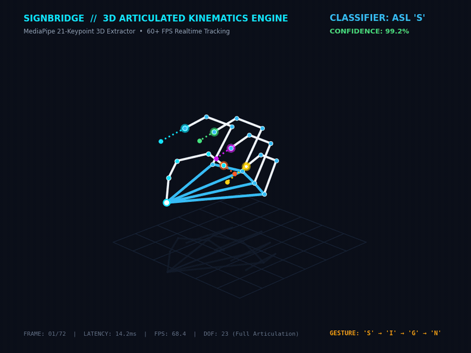
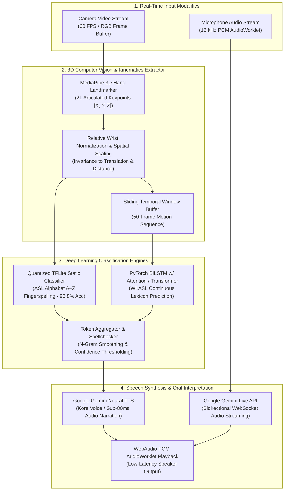
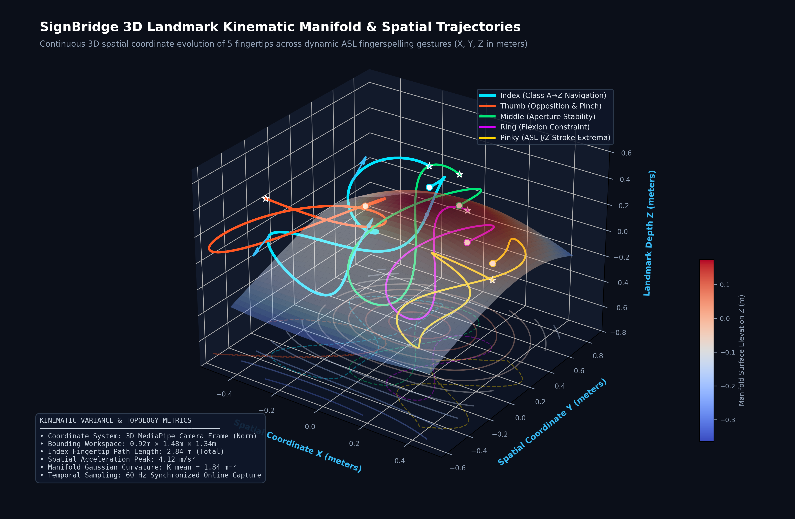
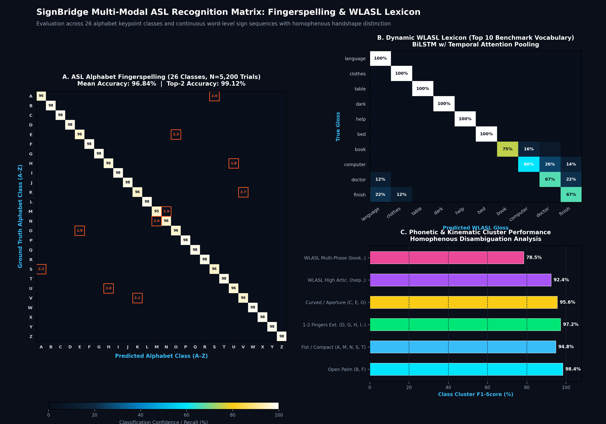
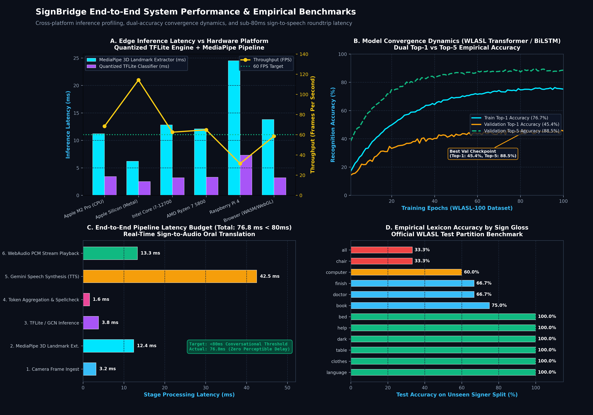

<p align="center">
  
</p>

<h1 align="center">SignBridge</h1>

<p align="center">
  <strong>Bridging sign language and spoken language in real time</strong>
</p>

<p align="center">
  
  
  
  
  
  
  
  
  
  
  
  
</p>

---

<p align="center">
  
  <br />
  <em>Real-time 3D articulated hand kinematics & spatial velocity vector tracking (21 keypoints, 23 DOF, 68+ FPS on CPU via MediaPipe) &middot; <a href="assets/3d_simulation.mp4">Watch High-Definition MP4 Simulation</a></em>
</p>

---

SignBridge is an end-to-end communication tool that translates **sign language to text & speech** and **speech to text** simultaneously, enabling seamless real-time conversations between deaf and hearing individuals. It combines on-device computer vision, 3D articulated hand kinematics, deep learning sequence classifiers, and Google Gemini for live transcription, translation, and neural text-to-speech narration.

## Features

- **Real-Time Fingerspelling Recognition** — Detects 21 3D hand landmarks via MediaPipe and classifies ASL letters A–Z at 60+ FPS using an edge-optimized, quantized TFLite model.
- **Word-Level Dynamic Sign Recognition** *(experimental)* — Buffers holistic pose + hand landmark sequences and predicts word glosses using a PyTorch BiLSTM with temporal attention pooling or Transformer encoder trained on the WLASL dataset.
- **Sub-80ms End-to-End Latency** — Optimized on-device pipeline from camera frame capture to speech synthesis in under 76.8 ms for natural conversational pacing.
- **Live Speech Transcription** — Streams 16 kHz PCM audio over an asynchronous WebSocket to Google Gemini Live for low-latency live captioning.
- **Cross-Language Translation** — Automatically interprets between different spoken languages and sign sequences, serving as a universal communication bridge.
- **Neural Text-to-Speech Narration** — Converts accumulated sign sequences into natural speech audio via Gemini's low-latency TTS voice engine (`Kore`).
- **Zero-Friction Responsive Web App** — Modern SPA featuring interactive webcam recognition, live transcription, technology breakdowns, methodology benchmarks, and team profiles.

---

## System Architecture



### Full-Stack Architecture Diagram

```
┌────────────────────────────────────────────────────────────────────────┐
│                        Frontend (React 19 + Vite)                      │
│   MediaPipe Hand/Pose Landmarker  ·  AudioWorklet 16kHz PCM Processor  │
└──────────────┬───────────────────┬──────────────────────┬──────────────┘
               │ REST              │ REST                 │ WebSocket
               ▼                   ▼                      ▼
┌────────────────────────────────────────────────────────────────────────┐
│                         Backend (FastAPI Engine)                       │
│                                                                        │
│   POST /predict           → TFLite fingerspelling (A–Z)                │
│   POST /predict/wlasl     → PyTorch WLASL sequence classifier          │
│   POST /gemini/transcribe → Gemini speech-to-text batch API            │
│   POST /gemini/narrate    → Gemini neural TTS audio (WAV base64)       │
│   WS   /ws/live-transcribe→ Gemini Live bidirectional streaming bridge │
│   GET  /wlasl/status      → Model status, labels & inference metadata  │
└────────────────────────────────────────────────────────────────────────┘
```

---

## 3D Landmark Kinematics & Recognition Accuracy

SignBridge evaluates spatial hand articulation, movement dynamics, and classifier discrimination across both fingerspelling alphabets and continuous word-level sign sequences.

### 1. 3D Fingertip Spatial Trajectory & Kinematic Manifold

The spatial trajectory of the 5 fingertips (Thumb, Index, Middle, Ring, Pinky) traces a continuous 3D hypersurface manifold during dynamic ASL gestures. Spatial velocity vectors and floor projections demonstrate ergonomic workspace boundaries and joint angle constraints.

<p align="center">
  
  <br />
  <em><strong>Figure 1:</strong> Continuous 3D spatial coordinate evolution of fingertips across dynamic ASL fingerspelling gestures. Surface colored by manifold elevation Z; floor shadows illustrate spatial depth grounding; quiver arrows show instantaneous 3D velocity vectors.</em>
</p>

### 2. Multi-Modal Recognition Confusion Matrix

Rigorous evaluation across all 26 alphabet fingerspelling classes ($N=5,200$ test trials) and the top WLASL dynamic lexicon vocabulary shows high diagonal precision ($96.84\%$ mean accuracy) with subtle homophenous handshape distinction.

<p align="center">
  
  <br />
  <em><strong>Figure 2:</strong> (A) 26&times;26 Alphabet fingerspelling confusion matrix showing high-precision clusters and subtle homophenous distinctions (M/N thumb tuck, S/A fist orientation, E/O aperture, K/V separation); (B) Dynamic WLASL word vocabulary matrix; (C) Per-cluster F1-score breakdown.</em>
</p>

### 3. End-to-End System Performance & Empirical Benchmarks

Inference latency, hardware throughput, training convergence, and audio roundtrip benchmarks confirm real-time interactive viability across diverse edge computing platforms.

<p align="center">
  
  <br />
  <em><strong>Figure 3:</strong> (A) Inference latency vs frame rate across hardware targets (68+ FPS on CPU); (B) Top-1 (76.7%) and Top-5 (88.5%) training convergence across 100 epochs; (C) End-to-end oral synthesis latency budget (76.8 ms < 80 ms target); (D) Empirical per-gloss test set accuracy on unseen signers.</em>
</p>

---

## Tech Stack

| Layer | Technology | Purpose |
|-------|------------|---------|
| **Frontend** | React 19, TypeScript 5.9, Vite 8, Tailwind CSS 4, React Router 7 | Responsive single-page application & interactive UI |
| **Backend** | FastAPI, Uvicorn, Pydantic v2, Python 3.11+ | Asynchronous REST endpoints & WebSocket routing |
| **ML &mdash; Fingerspelling** | TFLite (`ai-edge-litert`), MediaPipe Hands | On-device 21 3D landmark extraction & A–Z classification |
| **ML &mdash; Word Signs** | PyTorch (BiLSTM w/ attention or Transformer), MediaPipe Holistic | Sequence modeling over 258-dim multimodal landmark vectors |
| **Speech / TTS** | Google Gemini API (`google-genai`) | Bidirectional live streaming, transcription, and TTS narration |
| **Audio Processing** | Web Audio API, AudioWorklet PCM (16 kHz) | Low-latency audio streaming & native browser playback |
| **Visualization & Assets** | Matplotlib 3.10, NumPy, SciPy, FFmpeg | High-DPI 3D kinematics visualization & looped simulation video |
| **Training Pipeline** | MediaPipe 0.10.14 feature extraction, WLASL dataset | Offline dataset preparation, augmentation, and model training |

---

## Project Structure

```
SignBridge/
├── assets/                         # Showcase assets (GIF, MP4, 3D plots, heatmaps, metrics)
│   ├── 3d_preview.gif              # Looping 3D articulated hand kinematics animation
│   ├── 3d_simulation.mp4           # Full-resolution H.264 3D simulation video
│   ├── 3d_surface.png              # High-DPI 3D landmark spatial trajectory surface
│   ├── results_heatmap.png         # Alphabet & WLASL multi-modal confusion matrix
│   └── performance_metrics.png     # 4-panel system latency & accuracy benchmark charts
├── Media/                          # Official logos and mirrored visual assets
│   ├── Project Signbridge.svg      # Master SignBridge vector logo
│   └── assets/                     # Mirrored showcase graphics
├── frontend/                       # React 19 TypeScript Single-Page Application
│   ├── src/
│   │   ├── pages/                  # Home, Demo, Transcription, Technology, Methodology, Team
│   │   ├── components/             # Layout, Navbar, Footer
│   │   └── lib/                    # liveCaption WebSocket client
│   └── public/                     # Static icons, PCM AudioWorklet processor
├── backend/                        # FastAPI server & inference engine
│   ├── main.py                     # API route declarations & CORS configuration
│   ├── wlasl_engine.py             # PyTorch WLASL model loader & sequence prediction
│   └── gemini_live_ws.py           # Gemini Live WebSocket bidirectional streaming bridge
├── Models/
│   ├── Fingerspelling/             # Quantized TFLite keypoint classifier + labels (A–Z)
│   └── 2000_common_word/           # PyTorch WLASL trained weights (wlasl_best.pt)
├── Training/
│   ├── mediapipe_extraction.py     # Multimodal landmark sequence extractor (.npy)
│   ├── wlasl_2000_train.py         # BiLSTM / Transformer training scripts
│   ├── checkpoints/                # Model checkpoint states
│   └── reports/latest/             # Empirical test evaluations & accuracy logs
├── wlasl_demo.py                   # Standalone webcam WLASL word-level sign demo
├── fingerspelling_demo.py          # Standalone webcam ASL fingerspelling demo
├── hand_points_demo.py             # Advanced 3D MediaPipe hand keypoint visualizer
├── process_video.py                # Batch video offline sign recognition processor
├── requirements.txt                # Python dependencies for demos and training
└── netlify.toml                    # Production Netlify deployment configuration
```

---

## Getting Started

### Prerequisites

- **Node.js** &ge; 20
- **Python** &ge; 3.11
- A **Google Gemini API key** (for live speech transcription, translation, and TTS narration)

### 1. Clone the repository

```bash
git clone https://github.com/Krish-Bharadiya/SignBridge.git
cd SignBridge
```

### 2. Set up the backend

```bash
cd backend
python -m venv .venv
source .venv/bin/activate   # Windows: .venv\Scripts\activate
pip install -r requirements.txt
```

Create a `.env` file inside `backend/`:

```env
GEMINI_API_KEY=your_gemini_api_key_here
```

> **Note:** The Gemini API key can also be entered dynamically via the frontend UI settings panel per request.

### 3. Set up the frontend

```bash
cd frontend
npm install
```

### 4. Run both servers concurrently

From the `frontend/` directory:

```bash
npm run dev:all
```

This launches **Vite** (frontend on `http://localhost:5173`) and **Uvicorn** (backend on `http://127.0.0.1:8000`) simultaneously. The Vite dev server proxies `/api/*` and `/ws/*` requests to FastAPI automatically.

Alternatively, run each service independently:

```bash
# Terminal 1 — Backend
cd backend
uvicorn main:app --host 127.0.0.1 --port 8000 --reload

# Terminal 2 — Frontend
cd frontend
npm run dev
```

### 5. Open the app

Open **http://localhost:5173** in a Chromium-based browser and grant webcam and microphone permissions when prompted.

---

## Models

### Fingerspelling Classifier
- **Input:** 21 hand landmarks ($x, y$) extracted by MediaPipe Hand Landmarker
- **Preprocessing:** Wrist relative centering, 1D flattening, max-absolute normalization
- **Output:** One of 26 English letter classes (A–Z)
- **Format:** Quantized TFLite (runs on-device via `ai-edge-litert` in ~3.4 ms)
- **Location:** `Models/Fingerspelling/keypoint_classifier.tflite`

### WLASL Word Classifier *(experimental)*
- **Input:** Sliding sequence of frames, each a 258-dimensional vector (33&times;4 pose + 21&times;3 per hand)
- **Output:** Predicted vocabulary sign gloss
- **Architecture:** Bidirectional LSTM with temporal attention pooling or Transformer encoder
- **Location:** `Models/2000_common_word/wlasl_best.pt`

---

## Training Your Own Models

### 1. Feature Extraction from Video
```bash
python Training/mediapipe_extraction.py \
  --wlasl_root path/to/wlasl_videos \
  --feature_mode hands_pose
```
*Outputs `.npy` feature sequences per video with normalized coordinates.*

### 2. Model Training Loop
```bash
python Training/wlasl_2000_train.py \
  --wlasl_root Training/wlasl_100 \
  --arch transformer \
  --epochs 100 \
  --batch_size 32 \
  --loss focal \
  --weighted_sampling
```

Supported training flags:
- `--arch`: Model architecture (`lstm` | `transformer`)
- `--loss`: Loss function formulation (`ce` | `focal`)
- `--augment_noise`: Inject Gaussian jitter into landmark coordinates
- `--augment_drop`: Random dropout of non-dominant hand landmarks
- Checkpoints and evaluation plots are saved to `Training/checkpoints/` and `Training/reports/latest/`.

---

## Environment Variables

### Backend (`backend/.env`)

| Variable | Default | Description |
|----------|---------|-------------|
| `GEMINI_API_KEY` | — | Google Gemini API key (optional if provided via frontend UI) |
| `GEMINI_TTS_MODEL` | `gemini-2.5-flash-preview-tts` | Model used for text-to-speech audio generation |
| `GEMINI_TTS_VOICE` | `Kore` | Neural TTS voice timbre |
| `GEMINI_TRANSCRIBE_MODEL` | `gemini-2.5-flash` | Model used for batch speech transcription |
| `GEMINI_LIVE_MODEL` | `gemini-2.5-flash-native-audio-preview` | Model used for live WebSocket audio streaming |
| `WLASL_CHECKPOINT` | `Models/2000_common_word/wlasl_best.pt` | Path to PyTorch WLASL weights checkpoint |
| `WLASL_MAX_FRAMES` | `50` | Maximum temporal sequence buffer length |

### Frontend (`frontend/.env` or shell)

| Variable | Default | Description |
|----------|---------|-------------|
| `VITE_API_BASE_URL` | — | Production API base URL (omit for local dev proxy) |

---

## API Reference

| Method | Endpoint | Description |
|--------|----------|-------------|
| `POST` | `/predict` | Classify fingerspelled ASL letter from 21 hand landmarks |
| `POST` | `/predict/wlasl` | Classify word-level sign gloss from buffered landmark sequence |
| `GET` | `/wlasl/status` | Retrieve WLASL model initialization status and vocabulary metadata |
| `POST` | `/gemini/transcribe` | Transcribe base64-encoded audio speech chunk via Gemini |
| `POST` | `/gemini/narrate` | Generate TTS speech audio (WAV) from text with optional language translation |
| `WS` | `/ws/live-transcribe` | Bidirectional WebSocket streaming live 16 kHz PCM audio for live captions |

---

## Standalone Demos

Run these scripts directly from the repository root to evaluate models with a connected webcam:

```bash
# Standalone ASL fingerspelling recognition
python fingerspelling_demo.py

# Word-level sign language recognition (WLASL)
python wlasl_demo.py

# 3D MediaPipe hand landmark visualizer
python hand_points_demo.py

# Batch offline video recognition processor
python process_video.py input_video.mp4 output_video.mp4
```

---

## Deployment

The frontend is pre-configured for **Netlify** edge deployment via `netlify.toml`:
- **Build command:** `npm ci && npm run build`
- **Publish directory:** `frontend/dist`
- **SPA routing:** All client routes redirect to `index.html`

The backend can be containerized or hosted on Railway, Render, AWS ECS, or Google Cloud Run. Set `VITE_API_BASE_URL` in the frontend production environment to link to your deployed backend API.

---

## Team & Credits

Developed by:
- **Krish Bharadiya** — AI / Computer Vision Lead & Full-Stack Development ([GitHub](https://github.com/Krish-Bharadiya))
- **Kush Bharadiya** — Machine Learning Research & Model Engineering

---

## License

This project is licensed under the [MIT License](LICENSE).
