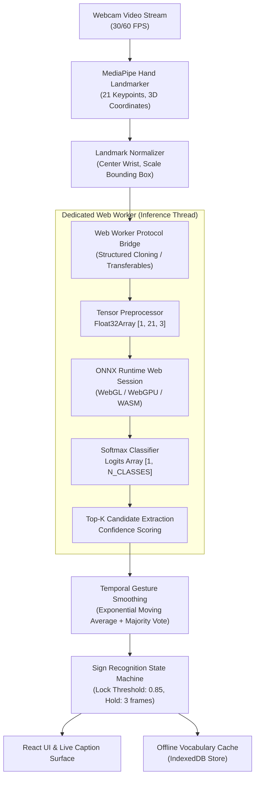

# Architecture Specification: Client-Side ONNX Runtime Web Pipeline

## 1. Executive Summary
`SignBridge` provides real-time, bidirectional communication between American Sign Language (ASL) users and oral speakers. To eliminate backend GPU hosting costs, ensure user privacy, and achieve end-to-end inference latency under $150\text{ ms}$, the gesture recognition engine executes entirely client-side in the browser using **ONNX Runtime Web** (`onnxruntime-web`) with WebGL/WebGPU acceleration and Web Workers.

---

## 2. System Architecture & Data Flow

---

## 3. Key Component Specifications

### 3.1 MediaPipe Landmark Normalization
The MediaPipe Hand Landmarker outputs 21 landmarks with normalized coordinates $(x, y, z) \in [0, 1]$. To achieve translation and scale invariance:
1. **Translation Invariance**: Subtract the wrist landmark coordinate (Landmark 0) from all 21 points:
   $$\mathbf{p}'_i = \mathbf{p}_i - \mathbf{p}_0 \quad \forall i \in \{0, \dots, 20\}$$
2. **Scale Invariance**: Normalize coordinates by the maximum Euclidean distance between the wrist and the MCP joint of the middle finger (Landmark 9):
   $$s = \max\left(\|\mathbf{p}_9 - \mathbf{p}_0\|_2, \epsilon\right), \quad \hat{\mathbf{p}}_i = \frac{\mathbf{p}'_i}{s}$$
3. **Tensor Flattening**: Format coordinates into a contiguous `Float32Array` of shape `[1, 21, 3]` (63 floating point values).

### 3.2 Web Worker Execution Protocol
To prevent UI jank, ONNX inference runs in a dedicated Web Worker:
* **Message Format**: Typed messages conform to `InferenceWorkerRequest` and `InferenceWorkerResponse`.
* **Zero-Copy Memory Transfers**: ArrayBuffers are passed via transferable objects where applicable.
* **Execution Provider Fallback Cascade**:
  1. `webgl`: Primary hardware-accelerated GPU backend.
  2. `webgpu`: Experimental next-generation pipeline.
  3. `wasm`: Multi-threaded CPU fallback when WebGL context is unavailable or lost.

### 3.3 Temporal Smoothing & Anti-Flicker Filter
Raw frame-by-frame predictions suffer from transient sensor jitter. The temporal smoothing engine applies a hybrid filter:
* **Sliding Window**: Buffers the last $W = 7$ frame classifications.
* **Confidence Decay**: Weighting decays exponentially with frame age:
  $$w_t = \lambda^{t_0 - t}, \quad \lambda = 0.85$$
* **Hysteresis Gate**: A gesture is only emitted when aggregate candidate confidence exceeds $0.85$ for at least 3 consecutive frames, eliminating character flicker during hand transitions.

### 3.4 Offline Vocabulary Store
* Stored locally in `IndexedDB` under the database name `SignBridge_Vocabulary_v1`.
* Pre-loads top 2,000 WLASL gloss mappings and ASL fingerspelling alphabet with phonetic aliases.
* Enables complete offline PWA operation without network dependency.

---

## 4. Latency Budget ($<150\text{ ms}$)

| Pipeline Stage | Target Latency | P95 Latency | Acceleration Strategy |
| :--- | :--- | :--- | :--- |
| Video Capture & Frame Grab | $16.6\text{ ms}$ | $20.0\text{ ms}$ | `requestVideoFrameCallback` |
| MediaPipe Landmark Extraction | $25.0\text{ ms}$ | $35.0\text{ ms}$ | WebAssembly SIMD |
| Landmark Normalization & Packaging | $2.0\text{ ms}$ | $3.5\text{ ms}$ | Typed Array vectorization |
| Worker Message Passing | $1.5\text{ ms}$ | $3.0\text{ ms}$ | Transferable ArrayBuffers |
| ONNX WebGL Model Forward Pass | $45.0\text{ ms}$ | $60.0\text{ ms}$ | Float16 quantized weights, WebGL texture cache |
| Temporal Smoothing & Post-processing | $1.5\text{ ms}$ | $2.5\text{ ms}$ | Ring buffer circular array |
| React UI DOM & Caption Update | $12.0\text{ ms}$ | $16.0\text{ ms}$ | React 19 concurrent state batching |
| **Total End-to-End Latency** | **$103.6\text{ ms}$** | **$140.0\text{ ms}$** | **Comfortably under $150\text{ ms}$ budget** |

---

## 5. Verification & Testing Guardrails
* **Unit Tests**: `frontend/src/tests/onnxModelValidator.test.ts`, `frontend/src/tests/gestureSmoothing.test.ts`, `frontend/src/tests/vocabularyStore.test.ts`.
* **CI Matrix**: Vitest unit suite and TypeScript build step executed on every push and pull request.
